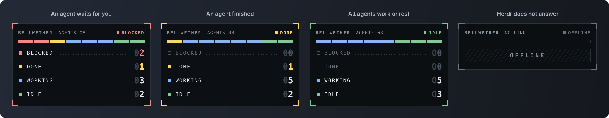
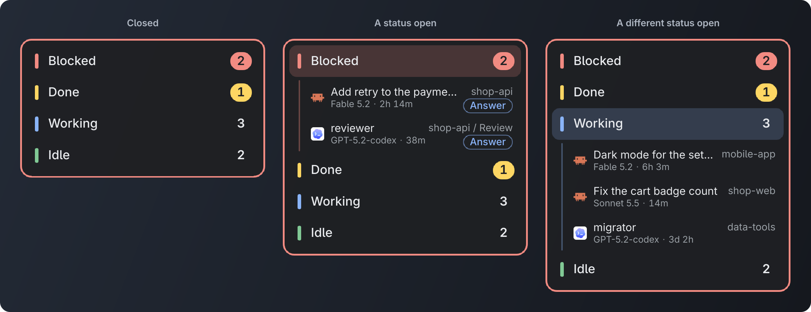
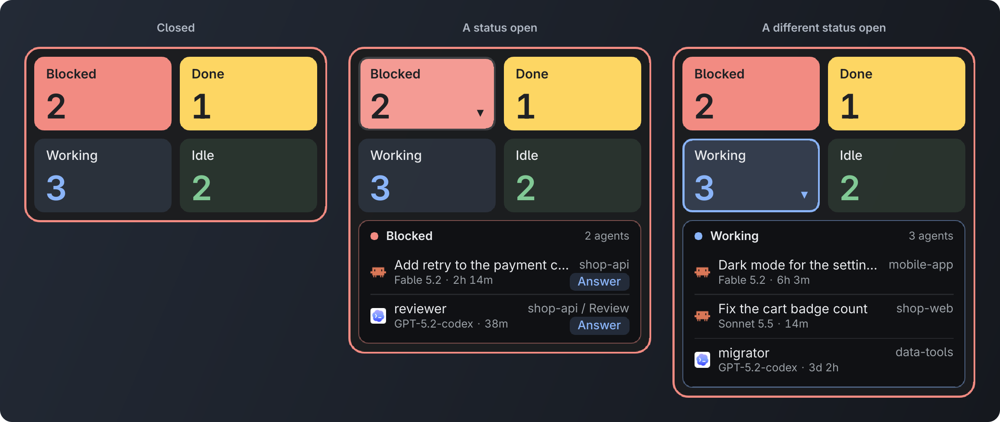
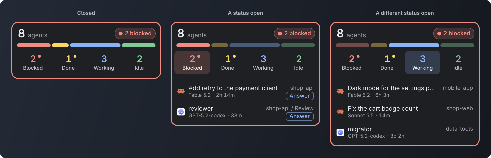
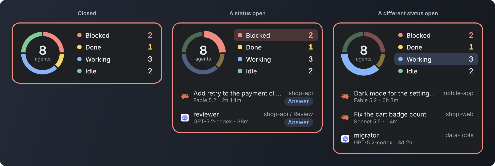
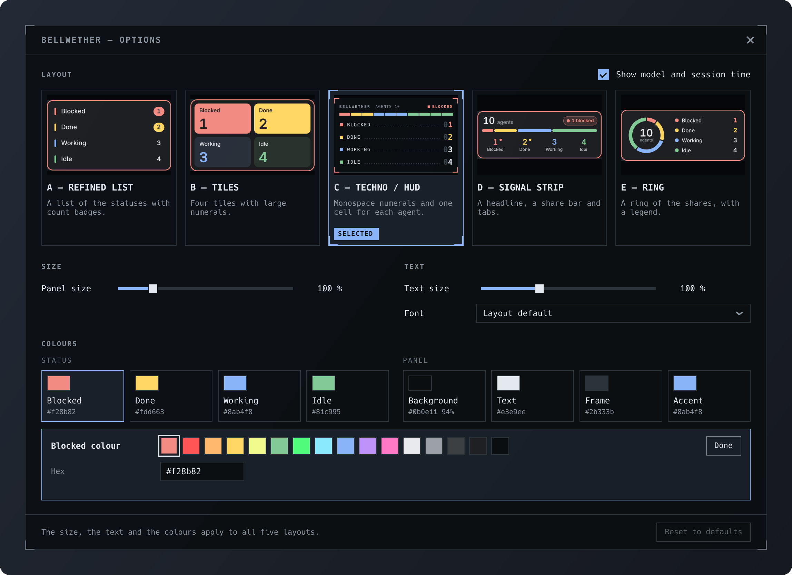
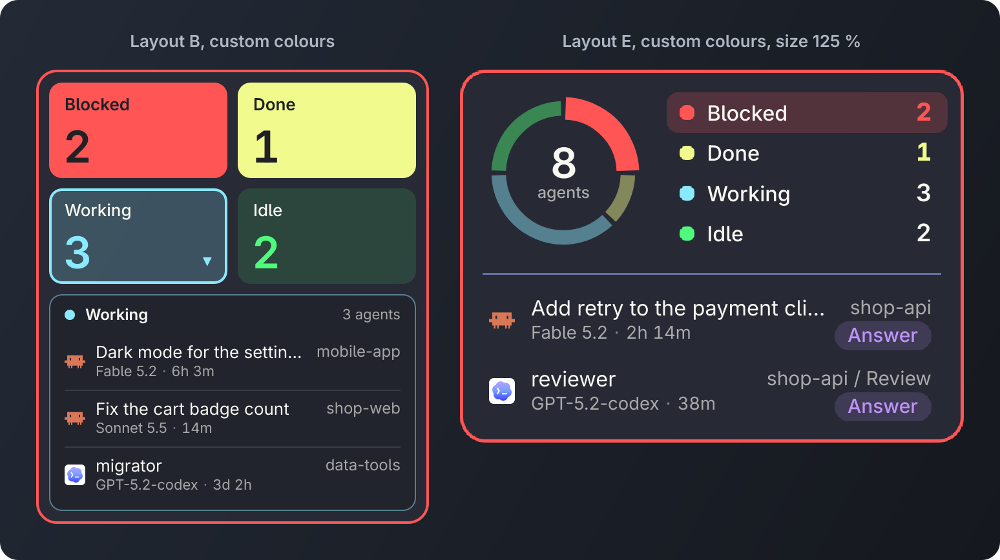

<h1 align="center">Bellwether</h1>

<b>Know which of your coding agents needs you. Answer it in two seconds. Go back to work.</b>

A small always-on-top panel for the Herdr desktop app · KDE Plasma 6 · Wayland

---

## The problem it solves

You run several coding agents at the same time. Each one stops now and then: it asks a question, it needs a permission, or it is finished. While you look at a different window, you do not see that, and the agent waits.

**Bellwether keeps that information on the screen at all times**, in a panel as small as a sticky note:

| You want to know | Bellwether shows |
|---|---|
| Does an agent wait for me? | A **red** frame and the count of blocked agents. |
| Is something finished? | A **yellow** frame and the count of done agents. |
| What does each agent do? | Its name, its place in Herdr, its model and its session time. |
| What does the agent ask? | The question and its options, in a small window. You answer with one click or one key. |

## Contents

- [A tour of the features](#a-tour-of-the-features)
- [Five looks](#five-looks)
- [Make it yours](#make-it-yours)
- [Will it run on my machine?](#will-it-run-on-my-machine)
- [Install](#install)
- [Start, stop, update, remove](#start-stop-update-remove)
- [Nothing shows?](#nothing-shows)
- [Privacy and safety](#privacy-and-safety)
- [Files](#files)
- [For developers](#for-developers)
- [Limits](#limits)

---

## A tour of the features

### 1. One look tells you the state of all agents

- **What it does:** the panel shows one count for each status, and its frame takes the colour of the most important status that has an agent. Blocked comes first, then done.
- **How it helps:** you do not read numbers. A red frame at the edge of your eye means "an agent waits". No red and no yellow means "nothing needs me".
- The panel stays above your other windows. Drag it to any place on any monitor. It remembers the place.
- A change in Herdr shows **at once**: Herdr tells Bellwether about each change, so the panel does not poll.

### 2. Every agent by name, with its model and session time

- **What it does:** click a status to list its agents. Each row shows the program icon, a **name**, the space and tab in Herdr, the **model** that the agent runs and **how long** its session exists.
- **The name is useful without any setup:** Bellwether uses the name of the terminal in Herdr. When there is none, it uses the title that the agent gave its terminal. Claude Code writes there what the session is about, for example "Add retry to the payment client".
- **How it helps:** you see which task waits, not only "terminal 7". You also see when an expensive model runs on a small task, and which session is days old.
- A list shows 8 agents. Turn the mouse wheel for more.

### 3. Answer a blocked agent without leaving your work

- **What it does:** a blocked agent has an **Answer** button. It opens a small window with the question of the agent and one button for each option. Click an option or press its number. Bellwether presses that key in the terminal of the agent.
- **How it helps:** the usual way is: find the Herdr window, find the tab, read, answer, go back. That is five steps and a lost thought. With Bellwether it is **one click and one key**, and your editor stays in front.
- It reads the dialogs of **Claude Code** and **Codex**: questions with options, free text ("Type something"), and permissions for commands, file edits and web fetches.

Bellwether is careful with your approval, because a wrong key in an agent can do harm:

- **You see what you approve.** The command or the diff shows in full. For a long one, the options that approve stay off until you saw it from the first line to the last.
- **Standing permissions have a red mark.** An option such as "always allow…" or "switch to auto mode" approves more than this one action. The mark stops you from choosing it by habit.
- **No answer to an old question.** Before each key, Bellwether reads the screen again. If the question is a different one now, it presses nothing and shows the new question.
- **No accidental key.** After each new question the number keys are locked for a moment.
- A program that Bellwether cannot read shows its screen as plain text, with a button **Open in Herdr**.

### 4. Jump to an agent

- **What it does:** click an agent row. The Herdr window comes to the front with that agent in view. If the Herdr app is closed, Bellwether starts it first.
- **How it helps:** when an answer needs more than one key, you are in the right terminal with one click.

### 5. It keeps working when the Herdr window is closed

- **What it does:** Herdr agents run on after you close the app window. Bellwether then reads the Herdr core directly. The agents keep their names and their status.
- **How it helps:** you can close the large Herdr window, keep the small panel, and still see the moment an agent needs you.

### 6. A tray icon that says the same

- **What it does:** the tray icon has the colour of the most important status. A left click shows or hides the panel. The menu has **Options…**, **Move to next screen** and **Quit**.
- **How it helps:** hide the panel during a call or a presentation. The tray icon still tells you when an agent waits.

---

## Five looks

The five layouts show the same data and work in the same way. Choose the one that fits your desktop. A change shows at once.

### A · Refined list

A quiet list with a colour bar and a count badge for each status. **Good for:** a desktop with a plain, modern look.

### B · Tiles

Four tiles with large numerals. The agents of the open tile show in a card below. **Good for:** reading the counts from far away, or on a second monitor.

### C · Techno / HUD (the default)

Monospace text, corner brackets, and one cell for each agent in the bar at the top. **Good for:** terminal users. The bar shows the share of each status in one line.

### D · Signal strip

A headline with the number of agents, one bar with the share of each status, and the four statuses as tabs. **Good for:** a compact, wide panel at the top of the screen.

### E · Ring

A ring with the share of each status and the number of all agents in its centre. **Good for:** seeing the balance between working and waiting agents.

---

## Make it yours

Right-click the tray icon and click **Options…**. Each change shows at once and is saved. No file to edit, no restart.

| Option | Range | How it helps |
|---|---|---|
| **Layout** | A to E | Fit the panel to your desktop. |
| **Panel size** | 75 % to 200 % | Small on a laptop, large on a 4K monitor. |
| **Text size** | 80 % to 140 % | Readable at your distance from the screen. |
| **Font** | Any installed font | Match your terminal or your desktop. |
| **Colours** | 4 status colours; background, text, frame, accent | Match your theme, or choose colours that you can tell apart. |
| **Show model and session time** | On or off | A shorter list when you do not need the second line. |
| **Reset to defaults** | | One control takes back every change of the look. |

Each colour has an editor inside the window, with samples and a hex field:

One set of values applies to all five layouts, the tray icon, the answer window and the options window:

---

## Will it run on my machine?

| | Supported | Not supported |
|---|---|---|
| **Operating system** | Linux | macOS, Windows |
| **Desktop** | KDE Plasma 6 | GNOME, Plasma 5, and other desktops |
| **Display server** | Wayland | X11 |
| **Agent host** | The Herdr desktop app (`herdr-app`) with its `herdr-core` | The `herdr` 0.9 terminal program |

Why these limits:

- The panel is a **layer-shell surface**. That is the Wayland way to put a small window above all other windows, on every virtual desktop, without an entry in the taskbar. GNOME does not have this protocol. X11 does not have it.
- Bellwether uses the KDE library **layer-shell-qt** for it, and KWin to bring the Herdr window to the front.
- Bellwether is tested on **CachyOS (Arch Linux)** with Plasma 6.8 and Qt 6.12. A different distribution with Plasma 6 on Wayland can work, but it is not tested.

What you need:

| Requirement | Version | Note |
|---|---|---|
| KDE Plasma on Wayland | 6 | Plasma 6.3 or later for the Herdr mark in the taskbar; older versions show a generic icon there. |
| Package `layer-shell-qt` | The one of your Plasma | Plasma normally installs it. |
| System Qt | **6.12** | It must have the same minor version as the PySide6 that Bellwether installs. See [the Qt version rule](docs/reference.md#the-qt-version-rule). |
| Python | 3.12 or later | |
| `uv` | Any recent | It installs PySide6 into a folder of the repository. No system Python package is changed. |
| Herdr desktop app | Tested with 0.1.16 | |
| `systemd-run` | A part of systemd | Needed to start a closed Herdr app from the panel. |

## Install

**1. Install the system package** (Arch Linux, CachyOS, Manjaro):

    sudo pacman -S --needed layer-shell-qt uv

On a different distribution, install the package that has the QML module `org.kde.layershell` (its name is `layer-shell-qt` in most of them) and install `uv`. This is not tested.

**2. Get the code and install it:**

    git clone git@github.com:carvares/bellwether.git
    cd bellwether
    uv venv --python /usr/bin/python3
    uv sync

`uv sync` installs PySide6 from PyPI into `.venv`. You do not need a system PySide6 package.

**3. Start it:**

    ./scripts/start.sh

The panel shows at the top right of your screen.

## Start, stop, update, remove

| To | Do this |
|---|---|
| **Start** | `./scripts/start.sh` in the repository folder. It starts in the background. A second start does not open a second panel. |
| **Start in the foreground** | `uv run python -m bellwether` |
| **Stop** | Right-click the tray icon, then **Quit**. With no tray icon: `pkill -f -x '(.*/)?python[0-9.]* -m bellwether'` |
| **Update** | `git pull`, then `uv sync`, then stop and start. |
| **Remove** | Stop it, then delete the repository folder and the three folders in [Files](#files). |

The panel stays on the screen until you log out or stop it. It also stays after you close the Herdr app.

### Start it with the Herdr app (optional)

The folder `mod/` is a small Herdr mod that runs `scripts/start.sh` when the app starts. Install it from the repository folder:

    ln -s "$PWD/mod" ~/.config/herdr-app/mods/bellwether
    herdr-app check ~/.config/herdr-app/mods/bellwether

- The link must stay a link: the mod finds the repository through it. Do not move the repository after this.
- The mod runs a program on your machine (`start.sh`). It does not use the network.
- Remove it with `rm ~/.config/herdr-app/mods/bellwether`.
- A person has not yet installed the mod. What is known and not known is in the [reference](docs/reference.md#start-with-the-herdr-app-the-details).

## Nothing shows?

| Check | What it tells you |
|---|---|
| `~/.local/state/bellwether/bellwether.log` | The line `source: app`, `source: core` or `source: none` shows where the counts come from. A missing QML module is named here. |
| `~/.local/state/bellwether/start.log` | The output of the process that `start.sh` starts, for example a Qt error before the log file opens. |
| `start.sh` ends with exit code 1 | `.venv/bin/python` does not exist. Run `uv sync` in the repository folder. |
| The panel is gone after a system upgrade | The system Qt has a new minor version. See [the Qt version rule](docs/reference.md#the-qt-version-rule). |
| The mod does not start the panel | Run `herdr-app status` and read its `errors`. |

## Privacy and safety

- Bellwether runs on your machine only. **It does not use the network.**
- It reads the lists of Herdr, and for each agent the title of the terminal, the model name and the time stamps of the session.
- It reads the **screen of one terminal** only when you click **Answer** for that agent. It presses a key there only after your click or your key.
- Screen text, typed text, terminal titles and session content are **never written** to the log or to a file. The log has addresses, program names and reason codes.

## Files

| File or folder | What it is |
|---|---|
| `~/.config/bellwether/state.json` | Your settings: position, layout, look. |
| `~/.local/state/bellwether/bellwether.log` | The log. |
| `~/.local/state/bellwether/start.log` | The output of starts with `start.sh`. |
| `~/.cache/bellwether/icons/` | Copies of program icons in your text colour. You can delete this folder. |

The keys of the settings file are in the [reference](docs/reference.md#files).

## For developers

    uv run pytest                              # the test suite (about 9 minutes)
    uv run python design/readme_shots.py       # make the pictures of this page again

- The pictures of this page are made from the real interface, off screen, with made-up agents. They are not screenshots of a desktop.
- The program is Python with PySide6 and QML. The design and every decision are in `docs/superpowers/specs/`.
- **[The reference](docs/reference.md)** has every rule of the panel, the answer window and the options in full.

## Limits

- The answer window reads Claude Code and Codex. For a different program it shows the screen as text.
- The model shows for Claude Code. For Codex it is not yet checked with a real session; a Codex row can show the time only.
- A new terminal title shows at the next status change of the agent, or after 5 minutes at the most.
- The jump to an agent on a different virtual desktop is not tested.
- An agent that reports "error" is counted as blocked, as in the agent list of the app.

The full list of limits, and of what a person has not yet checked, is in the [reference](docs/reference.md#limits).
