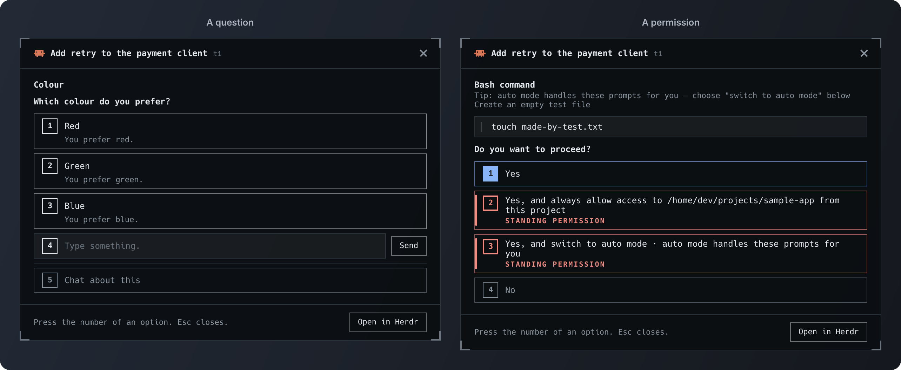
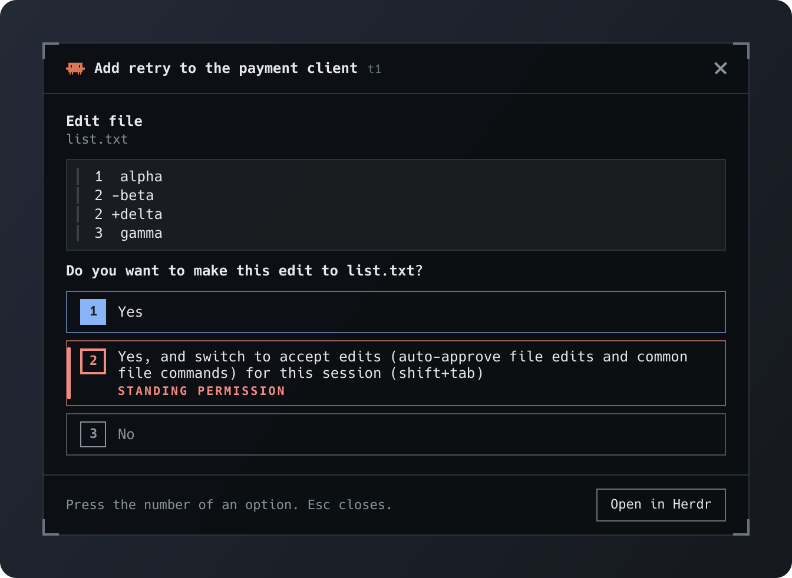
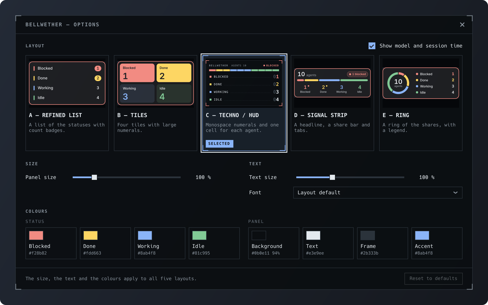

# Bellwether

**See at a glance which of your Herdr agents need you, and answer them without leaving your work.**

Bellwether is a small always-on-top panel for the Herdr desktop app. It shows how many agents are **blocked**, **done**, **working** and **idle**, lists them by name, and lets you answer a blocked agent from a small window. For KDE Plasma 6 on Wayland.

## Contents

- [Features](#features)
- [Install](#install)
- [Start](#start)
- [Start with the Herdr app (optional)](#start-with-the-herdr-app-optional)
- [Nothing shows?](#nothing-shows)
- [Privacy](#privacy)
- [Files](#files)
- [Tests](#tests)
- [Limits](#limits)
- [Reference](docs/reference.md): every rule in full

## Features

### The status of every agent, always in view

- The panel stays above your windows. You can drag it to any place on any monitor, and it remembers the place.
- It shows one count for each status. The frame has the colour of the most important status that has an agent: **blocked** first, then **done**.
- Click a status to see its agents. Click it again to close the list. A list shows 8 agents; turn the mouse wheel for more.
- A change in Herdr shows at once: `herdr-core` tells Bellwether about each change, so the panel does not poll.
- The panel keeps working when you close the Herdr window. The agents keep their names and their status.

### Agents by name, with model and session time

- **The name** of a row is the name of the terminal in Herdr. When it has none, the row shows the **title** that the agent gave its terminal (Claude Code writes what the session is about). The space and the tab show at the right.
- **The second line** shows the model that the agent runs and how long its session exists, for example "Fable 5.2 · 2h 14m". The model shows for Claude Code (for Codex when Bellwether can read its session file); the time shows for every program. You can turn it off in the options.
- Each row has the icon that Herdr shows for the program.

### Jump to an agent

- Click an agent row. The Herdr window comes to the front with that agent in view.
- When the Herdr app is closed, Bellwether starts it first.

### Answer a blocked agent

- A blocked agent has an **Answer** button in its row. It opens a small window with the question of the agent and one button for each option.
- Click an option or press its number. Bellwether presses that key in the terminal of the agent, and the agent goes on.
- **Questions and permissions.** The window reads the dialogs of Claude Code and Codex: questions with options, free text ("Type something"), and permissions for commands, file edits and web fetches.
- **You see what you approve.** A command or a file diff shows in full. For a long one, the options that approve stay off until you saw it from the top to the end.

- **Standing permissions are marked.** An option that approves more than this one action ("always allow…", "switch to auto mode") has a red mark, so that you do not choose it by habit.
- **No stale answers.** Before each key, Bellwether reads the screen again. If the question changed, it presses nothing and shows the new question. The number keys stay locked for a moment after each new question.
- A program that Bellwether cannot read shows its screen as text, with **Open in Herdr**.

### Five layouts

All five show the same data and work in the same way. Only the look is different.

| | Layout | What it looks like |
|---|---|---|
| **A** | Refined list | A list of the four statuses with a colour bar and a count badge. |
| **B** | Tiles | Four tiles with large numerals. |
| **C** | Techno / HUD (the default) | Monospace text, corner brackets and one cell for each agent. |
| **D** | Signal strip | A headline, one bar with the share of each status, and four tabs. |
| **E** | Ring | A ring with the share of each status, and a legend. |

### Options and your own look

Right-click the tray icon and click **Options…**. Each change shows at once and is saved.

- **Layout:** choose one of the five.
- **Panel size:** 75 % to 200 %.
- **Text size:** 80 % to 140 %, and the **font**.
- **Colours:** the four status colours, and the background, text, frame and accent of the panel.
- **Show model and session time:** on or off.
- **Reset to defaults** takes back every change of the look.

### Tray icon

- The tray icon is the Herdr mark in the colour of the most important status.
- Left-click shows or hides the panel. The menu has **Options…**, **Move to next screen** and **Quit**.

## Install

You need KDE Plasma 6 on Wayland and `uv`.
You also need the package `layer-shell-qt`. Plasma normally installs it.

    sudo pacman -S --needed layer-shell-qt

Then, in the repository folder:

    uv venv --python /usr/bin/python3
    uv sync

`uv sync` installs PySide6 from PyPI (`pyside6-essentials==6.12.*`).
You do not need a system PySide6 package.

### Version note

The widget loads the system QML module `org.kde.layershell` into the Qt of the PySide6 wheel.
This works while the system Qt and the wheel Qt have the same minor version (now 6.12).
A system upgrade to a new Qt minor version (for example 6.13) can stop the module from loading.
Then the widget does not show, and the log file names the missing module.
To fix it, change the pin in `pyproject.toml` to the new minor version (for example `pyside6-essentials==6.13.*`).
Then run `uv sync`.

## Start

Run this in the repository folder:

    ./scripts/start.sh

The widget starts in the background and stays on the screen until you log out or stop it.
It stays also after you close the Herdr app.
A second start does not open a second widget.

Stop the widget: right-click the tray icon, then click "Quit".
If there is no tray icon, stop the widget with this command:

    pkill -f -x '(.*/)?python[0-9.]* -m bellwether'

To run the widget in the foreground:

    uv run python -m bellwether

## Start with the Herdr app (optional)

The folder `mod/` is a small Herdr app mod. It runs `scripts/start.sh` each time the app starts a copy of the mod.
The documentation of the app says when that occurs: at the install, at the start of the app, in each window, after a change of layout, and after a save of a file of the mod.
So after "Quit" from the tray, the widget can come back before the next start of the app.
Repeated starts do no harm: only one widget runs at a time.
The mod runs a program on your machine (`start.sh`). It does not use the network.

Install it. Run this in the repository folder:

    ln -s "$PWD/mod" ~/.config/herdr-app/mods/bellwether
    herdr-app check ~/.config/herdr-app/mods/bellwether

The link must stay a link: the mod finds the repository through it.
Do not move the repository after this, or make the link again.

What is known and not known about the mod:

- `herdr-app check` passes for `mod/`.
- A mod starts only when the app shows it. The documentation of the app says that the app then puts a new mod into the window. `mod.json` asks for a block at the bottom, 1 pixel high. The mod draws nothing in it.
- A person has not yet installed the mod. These things are not checked: how the block looks, if the app accepts a linked mod folder, and if the app starts the mod again at each start.

Remove the automatic start:

    rm ~/.config/herdr-app/mods/bellwether

If the empty block stays in the window after that, remove it from your layout in the app.

## Nothing shows?

- Read the log file `~/.local/state/bellwether/bellwether.log`. The line `source: app`, `source: core` or `source: none` shows where the counts come from.
- Read the start log `~/.local/state/bellwether/start.log`. It holds the output of the widget process that `scripts/start.sh` starts, for example a Qt error before the log file opens. A start while a widget runs already writes the line `bellwether: already running` here.
- `scripts/start.sh` stops with exit code 1 and a message when `.venv/bin/python` does not exist. Then run `uv sync` in the repository folder.
- If the mod does not start the widget, run `herdr-app status` and read its `errors`.

## Privacy

- Bellwether runs on your machine only. It does not use the network.
- It reads the lists of Herdr (`herdr-app ls`, `herdr-core ls`), and for each agent the title of the terminal, the model name and the time stamps of the session.
- It reads the **screen of one terminal** only when you click **Answer** for that agent, and it presses a key there only after your click or key.
- Screen text, typed text, terminal titles and session content are never written to the log or to a file. The log has addresses, program names and reason codes.

## Files

- Settings (position, layout, look): `~/.config/bellwether/state.json`
- Log: `~/.local/state/bellwether/bellwether.log`
- Start log: `~/.local/state/bellwether/start.log`
- Icon copies: `~/.cache/bellwether/icons/` (you can delete this folder)

The keys of the settings file are in the [reference](docs/reference.md#files).

## Tests

    uv run pytest

The pictures of this page are made from the real interface, off screen, with made-up agents:

    uv run python design/readme_shots.py

## Limits

- KDE Plasma 6 on Wayland only. The panel needs the layer-shell protocol of KWin.
- Bellwether reads the Herdr desktop app (`herdr-app`) and its `herdr-core`. It does not read the `herdr` 0.9 terminal program.
- The answer window reads Claude Code and Codex. For a different program it shows the screen as text.
- The model shows for Claude Code. For Codex it is not yet checked with a real session; a Codex row can show the time only.
- A new terminal title shows at the next status change of the agent, or after 5 minutes at the most.

The full list of limits, and of what a person has not yet checked, is in the [reference](docs/reference.md#limits).
