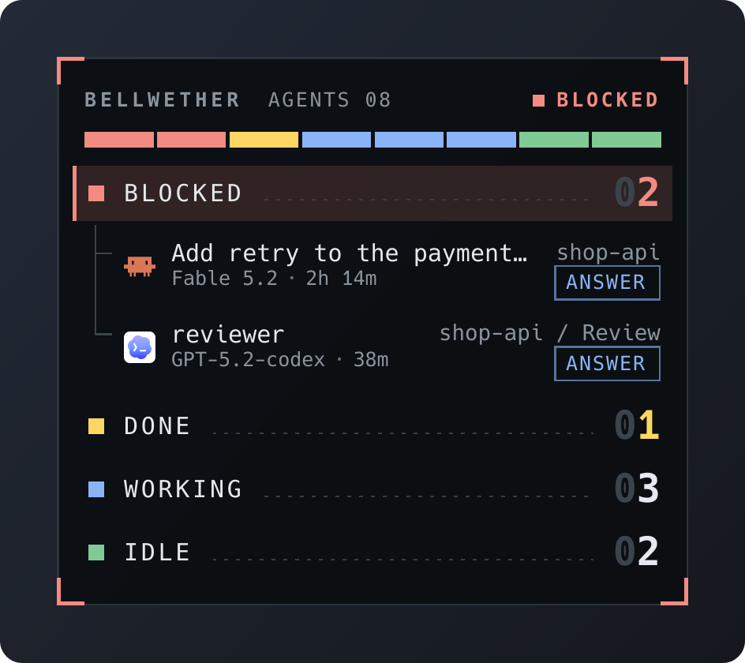
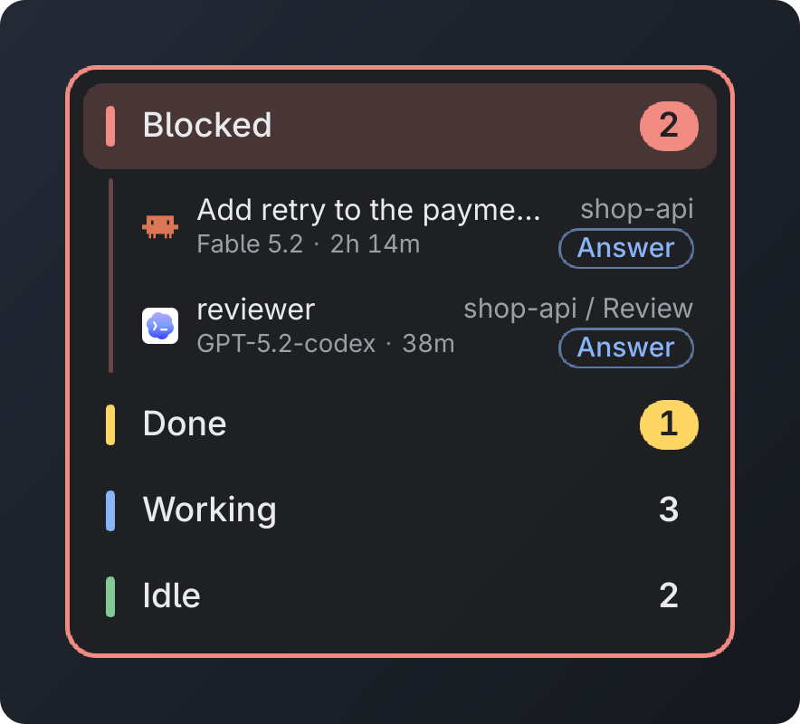
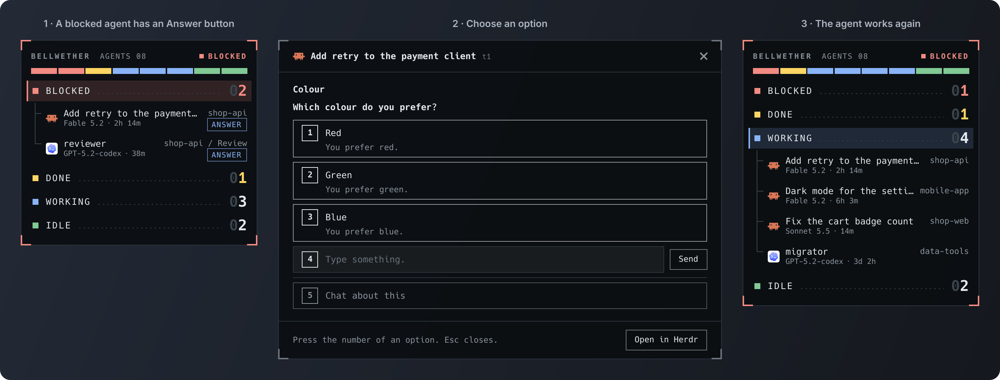
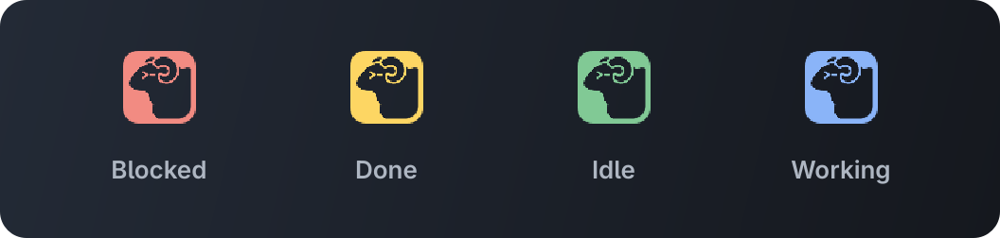
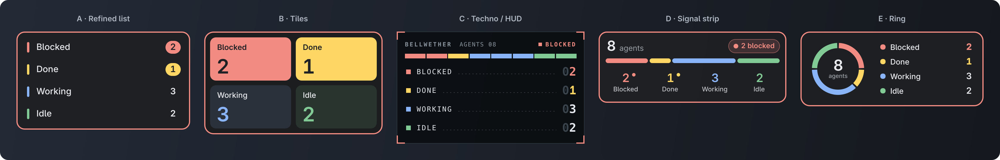
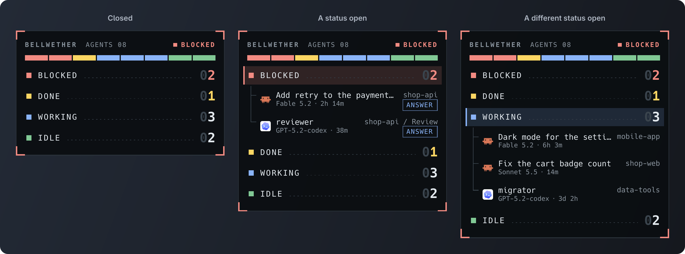
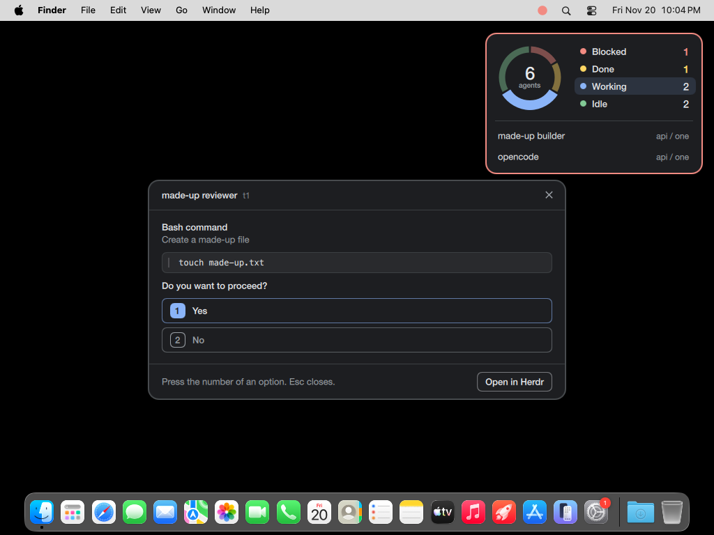
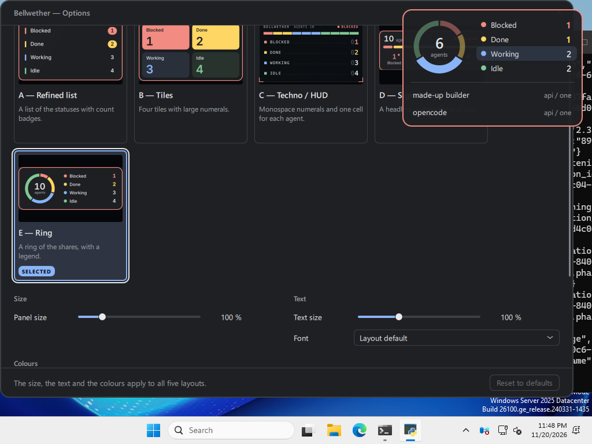

<h1 align="center">Bellwether</h1>

<b>Know which of your coding agents needs you. Answer it in two seconds. Go back to work.</b>

A small always-on-top panel for the Herdr desktop app · Linux · macOS · Windows

---

## The problem it solves

You run several coding agents at the same time. Each one stops now and then: it asks a question, it needs a permission, or it is finished. While you look at a different window, you do not see that, and the agent waits.

**Bellwether keeps that information on the screen at all times**, in a panel as small as a sticky note:

| You want to know | Bellwether shows |
|---|---|
| Does an agent wait for me? | A **red** frame and the count of blocked agents. |
| Is something finished? | A **yellow** frame and the count of done agents. |
| What does each agent do? | Its name, its place in Herdr, its model and its session time. |
| What does the agent ask? | The question and its options, in a small window. You answer with one click or one key. |

## Contents

- [A tour of the features](#a-tour-of-the-features)
- [Five looks](#five-looks)
- [Make it yours](#make-it-yours)
- [On macOS and Windows](#on-macos-and-windows)
- [Will it run on my machine?](#will-it-run-on-my-machine)
- [Install](#install)
- [Start, stop, update, remove](#start-stop-update-remove)
- [Nothing shows?](#nothing-shows)
- [Privacy and safety](#privacy-and-safety)
- [Files](#files)
- [For developers](#for-developers)
- [Limits](#limits)

---

## A tour of the features

### 1. One look tells you the state of all agents

- **What it does:** the panel shows one count for each status, and its frame takes the colour of the most important status that has an agent. Blocked comes first, then done.
- **How it helps:** you do not read numbers. A red frame at the edge of your eye means "an agent waits". No red and no yellow means "nothing needs me".
- The panel stays above your other windows. Drag it to any place on any monitor. It remembers the place.
- A change in Herdr shows **at once**: Herdr tells Bellwether about each change, so the panel does not poll.

### 2. Every agent by name, with its model and session time

- **What it does:** click a status to list its agents. Each row shows the program icon, a **name**, the space and tab in Herdr, the **model** that the agent runs and **how long** its session exists.
- **The name is useful without any setup:** Bellwether uses the name of the terminal in Herdr. When there is none, it uses the title that the agent gave its terminal. Claude Code writes there what the session is about, for example "Add retry to the payment client".
- **How it helps:** you see which task waits, not only "terminal 7". You also see when an expensive model runs on a small task, and which session is days old.
- A list shows 8 agents. Turn the mouse wheel for more.

### 3. Answer a blocked agent without leaving your work

- **What it does:** a blocked agent has an **Answer** button. It opens a small window with the question of the agent and one button for each option. Click an option or press its number. Bellwether presses that key in the terminal of the agent.
- **How it helps:** the usual way is: find the Herdr window, find the tab, read, answer, go back. That is five steps and a lost thought. With Bellwether it is **one click and one key**, and your editor stays in front.
- It reads the dialogs of **Claude Code** and **Codex**: questions with options, free text ("Type something"), and permissions for commands, file edits and web fetches.

Bellwether is careful with your approval, because a wrong key in an agent can do harm:

- **You see what you approve.** The command or the diff shows in full. For a long one, the options that approve stay off until you saw it from the first line to the last.
- **Standing permissions have a red mark.** An option such as "always allow…" or "switch to auto mode" approves more than this one action. The mark stops you from choosing it by habit.
- **No answer to an old question.** Before each key, Bellwether reads the screen again. If the question is a different one now, it presses nothing and shows the new question.
- **No accidental key.** After each new question the number keys are locked for a moment.
- A program that Bellwether cannot read shows its screen as plain text, with a button **Open in Herdr**.

### 4. Jump to an agent

- **What it does:** click an agent row. The Herdr window comes to the front with that agent in view. If the Herdr app is closed, Bellwether starts it first.
- **How it helps:** when an answer needs more than one key, you are in the right terminal with one click.

### 5. It keeps working when the Herdr window is closed

- **What it does:** Herdr agents run on after you close the app window. Bellwether then reads the Herdr core directly. The agents keep their names and their status.
- **How it helps:** you can close the large Herdr window, keep the small panel, and still see the moment an agent needs you.

### 6. A tray icon that says the same

- **What it does:** the tray icon has the colour of the most important status. A left click shows or hides the panel. The menu has **Options…**, **Move to next screen** and **Quit**.
- **Where it is:** in the system tray on Linux, in the menu bar on macOS, and in the notification area of the taskbar on Windows.
- **How it helps:** hide the panel during a call or a presentation. The tray icon still tells you when an agent waits.

---

## Five looks

The five layouts show the same data and work in the same way. Choose the one that fits your desktop. A change shows at once.

### A · Refined list

A quiet list with a colour bar and a count badge for each status. **Good for:** a desktop with a plain, modern look.

### B · Tiles

Four tiles with large numerals. The agents of the open tile show in a card below. **Good for:** reading the counts from far away, or on a second monitor.

### C · Techno / HUD (the default)

Monospace text, corner brackets, and one cell for each agent in the bar at the top. **Good for:** terminal users. The bar shows the share of each status in one line.

### D · Signal strip

A headline with the number of agents, one bar with the share of each status, and the four statuses as tabs. **Good for:** a compact, wide panel at the top of the screen.

### E · Ring

A ring with the share of each status and the number of all agents in its centre. **Good for:** seeing the balance between working and waiting agents.

---

## Make it yours

Right-click the tray icon and click **Options…**. Each change shows at once and is saved. No file to edit, no restart.

| Option | Range | How it helps |
|---|---|---|
| **Layout** | A to E | Fit the panel to your desktop. |
| **Panel size** | 75 % to 200 % | Small on a laptop, large on a 4K monitor. |
| **Text size** | 80 % to 140 % | Readable at your distance from the screen. |
| **Font** | Any installed font | Match your terminal or your desktop. |
| **Colours** | 4 status colours; background, text, frame, accent | Match your theme, or choose colours that you can tell apart. |
| **Show model and session time** | On or off | A shorter list when you do not need the second line. |
| **Reset to defaults** | | One control takes back every change of the look. |

Each colour has an editor inside the window, with samples and a hex field:

One set of values applies to all five layouts, the tray icon, the answer window and the options window:

On a narrow screen the options window gets narrower: the layout cards go into two or three rows, and the sections go one below the other.

---

## On macOS and Windows

 

These are pictures of GitHub's CI machines with **made-up agents**. They are not pictures of a person's desktop.

- **Left, macOS 26.7.2:** the panel stays above the answer window, and the answer window has the keyboard. The red dot in the menu bar is the tray icon. It is a circle because that machine has no Herdr app.
- **Right, Windows Server 2025:** the panel stays above the options window. The options window fits the small screen of the machine (1024 × 768). At the right edge is the console window of the CI machine.

---

## Will it run on my machine?

Bellwether runs on Linux, macOS and Windows. It is not tested in the same way on each system. This page uses three levels:

- **Tested by a person:** the author uses Bellwether on their own desktop.
- **Tested on a CI machine, not by a person:** a GitHub Actions machine ran the real program on that system, with made-up agents, and checked the facts of its windows. No person has used it there.
- **Limited:** it runs, but a limit of the system changes how the panel behaves.

| System | Level | In one line |
|---|---|---|
| **Linux**, KDE Plasma 6 on Wayland | **Tested by a person** | The author's desktop: CachyOS (Arch Linux), Plasma 6.8, Qt 6.12. Everything on this page works here. |
| **macOS** | **Tested on a CI machine, not by a person** | A GitHub machine with macOS 26.7.2 on Apple Silicon. |
| **Windows** | **Tested on a CI machine, not by a person** | A GitHub machine with Windows Server 2025. Windows 10 and 11 are not tested. |
| **Linux on X11** | **Limited** | It works, with one known limit: a desktop "work area" can move the panel on a lower monitor. |
| **Linux**, GNOME or a different Wayland desktop without the layer-shell protocol | **Limited** | A normal window: it is not kept above the other windows, and it can take the keyboard. This is not the Bellwether experience. |

On every system the agent host is the Herdr desktop app (`herdr-app`) with its `herdr-core`. The `herdr` 0.9 terminal program is not supported.

### What the CI machines proved

A GitHub machine installs Bellwether, runs a selected set of the tests, and runs the real program on its own screen. On macOS and on Windows it proved:

- **The panel shows above the other windows and does not take the keyboard.** On macOS it is a non-activating panel at the status level, set to show on every Space. On Windows it is a topmost window with no activation.
- **The panel stays out of the Dock (macOS) and out of the taskbar (Windows).** Bellwether shows its icon only in the menu bar (macOS) or in the notification area (Windows).
- **The start does not take the keyboard** from the app in front.
- **The options window and the answer window get the keyboard** when they open. The panel stays above them.
- **The panel is not under the menu bar, the Dock or the taskbar.**
- **A smoke run with a made-up Herdr:** the start script starts one panel, the panel reads the made-up app and its event stream, and after a kill of the panel its child process ends within 3 seconds.

What a CI machine cannot prove: no person sits at it, and it has no real Herdr app and no real agent. Nobody has looked at the panel there, dragged it, or clicked it with a real mouse. On the CI machine the windows got the keyboard with no click of a person; on a real Mac and on a real Windows PC, the system decides after the click of the person. The list of open checks is in [Not verified by a person](#not-verified-by-a-person).

### Why the limits

- **KDE Plasma on Wayland.** The panel is a **layer-shell surface**. That is the Wayland way to put a small window above all other windows, on every virtual desktop, without an entry in the taskbar. Bellwether uses the KDE library **layer-shell-qt** for it, and KWin to bring the Herdr window to the front. A different distribution with Plasma 6 on Wayland can work, but it is not tested.
- **Linux on X11.** X11 has no layer shell, so Bellwether uses its second window shell: a frameless window that asks to stay above the others and not to take the keyboard. X11 gives that. But the window manager keeps such a window inside the X11 work area, and X11 has one work area for the whole desktop. With two monitors at different heights, a panel high on the lower monitor moves down. This was checked under XWayland on KDE, not in a real X11 session.
- **GNOME and other Wayland desktops.** On Wayland, only the layer-shell protocol lets a program stay above all windows, keep away from the keyboard, and choose its own place. GNOME does not have this protocol. The panel is then a normal window: the desktop places it, other windows can cover it, it takes the keyboard at its start, and it has a taskbar entry. A drag moves it, but its place is not saved. This was checked on KDE with the second shell forced, not on GNOME.
- **macOS and Windows** always use the second window shell. There, the system itself keeps the panel above the other windows and away from the keyboard.

### What you need

| Requirement | Linux (KDE Plasma 6) | macOS | Windows |
|---|---|---|---|
| **System** | KDE Plasma 6 on Wayland. Plasma 6.3 or later for the Herdr mark in the taskbar; older versions show a generic icon there. | macOS 12.3 or later for `start.sh`, which needs `readlink -f`. Tested on 26.7.2 only. | Windows 10 or 11. Tested on Windows Server 2025 only. |
| **Python** | 3.12 or later | 3.12 or later | 3.12 or later |
| **`uv`** | Any recent | Any recent | Any recent |
| **What `uv sync` installs into `.venv`** | PySide6 | PySide6, psutil, pyobjc (Cocoa) | PySide6, psutil |
| **System parts** | Package `layer-shell-qt`, from your Plasma. System Qt **6.12**: it must have the same minor version as the PySide6 that Bellwether installs (see [the Qt version rule](docs/reference.md#the-qt-version-rule)). `systemd-run`, to start a closed Herdr app from the panel. | None | None |
| **Herdr desktop app** | Tested with 0.1.16 | Herdr 0.1.16 is for Apple Silicon only. Not tested with Bellwether. | Herdr 0.1.16 has a Windows build (x86_64). Not tested with Bellwether. |

`uv` installs the Python packages into a folder of the repository. No system Python package is changed. On Linux on X11 or on a different desktop, `layer-shell-qt` and the Qt version rule do not apply: they are only for the layer shell.

## Install

### Linux (KDE Plasma 6)

**1. Install the system package** (Arch Linux, CachyOS, Manjaro):

    sudo pacman -S --needed layer-shell-qt uv

On a different distribution, install the package that has the QML module `org.kde.layershell` (its name is `layer-shell-qt` in most of them) and install `uv`. This is not tested.

**2. Get the code and install it:**

    git clone git@github.com:carvares/bellwether.git
    cd bellwether
    uv venv --python /usr/bin/python3
    uv sync

`uv sync` installs PySide6 from PyPI into `.venv`. You do not need a system PySide6 package.

**3. Start it:**

    ./scripts/start.sh

The panel shows at the top right of your screen.

### macOS

Install Python 3.12 or later and `uv`. Then, in Terminal:

    git clone git@github.com:carvares/bellwether.git
    cd bellwether
    uv sync
    ./scripts/start.sh

`uv sync` installs PySide6, psutil and pyobjc into `.venv`. The panel shows at the top right of the screen, below the menu bar. Bellwether has no Dock icon: its icon is in the menu bar.

### Windows

Install Python 3.12 or later and `uv`. Then, in a Command Prompt:

    git clone git@github.com:carvares/bellwether.git
    cd bellwether
    uv sync
    scripts\start.cmd

`uv sync` installs PySide6 and psutil into `.venv`. `start.cmd` starts Bellwether with no console window. The panel shows at the top right of the screen. It has no taskbar button: its icon is in the notification area of the taskbar.

## Start, stop, update, remove

| To | Linux | macOS | Windows |
|---|---|---|---|
| **Start** | `./scripts/start.sh` | `./scripts/start.sh` | `scripts\start.cmd` |
| **Start in the foreground** | `uv run python -m bellwether` | `uv run python -m bellwether` | `uv run python -m bellwether` |
| **Stop** | Right-click the tray icon, then **Quit**. With no tray icon: `pkill -f -x '(.*/)?python[0-9.]* -m bellwether'` | Open the menu of the icon in the menu bar, then **Quit**. A tested command for a stop without the icon is not there yet. | Right-click the icon in the notification area, then **Quit**. A tested command for a stop without the icon is not there yet. |
| **Update** | `git pull`, then `uv sync`, then stop and start. | The same. | The same. |
| **Remove** | Stop it, then delete the repository folder and the folders in [Files](#files). | The same. | The same. |

Run each command in the repository folder. The start script starts Bellwether in the background and returns at once. A second start does not open a second panel. The panel stays on the screen until you log out or stop it. It also stays after you close the Herdr app.

### Start it with the Herdr app (optional, Linux and macOS)

The folder `mod/` is a small Herdr mod that runs `scripts/start.sh` when the app starts. Install it from the repository folder:

    ln -s "$PWD/mod" ~/.config/herdr-app/mods/bellwether
    herdr-app check ~/.config/herdr-app/mods/bellwether

- The link must stay a link: the mod finds the repository through it. Do not move the repository after this.
- The mod runs a program on your machine (`start.sh`). It does not use the network.
- Remove it with `rm ~/.config/herdr-app/mods/bellwether`.
- A person has not yet installed the mod. What is known and not known is in the [reference](docs/reference.md#start-with-the-herdr-app-the-details).
- **macOS:** the same commands, but this is not tested on a Mac.
- **Windows:** this is not there yet. The mod runs `start.sh`, and Windows needs `start.cmd`. Start Bellwether by hand.

## Nothing shows?

First find the log folder of your system:

| Linux | macOS | Windows |
|---|---|---|
| `~/.local/state/bellwether/` | `~/Library/Logs/bellwether/` | `%LOCALAPPDATA%\bellwether\Logs\bellwether\` |

| Check | What it tells you |
|---|---|
| `bellwether.log` in the log folder | The line `source: app`, `source: core` or `source: none` shows where the counts come from. The line `shell: layer` or `shell: plain` shows the window shell. A missing QML module is named here. |
| `start.log` in the log folder | The output of the process that the start script starts, for example a Qt error before the log file opens. |
| `start.sh` or `start.cmd` ends with exit code 1 | `.venv/bin/python` (Windows: `.venv\Scripts\pythonw.exe`) does not exist. Run `uv sync` in the repository folder. |
| Linux, KDE: the panel is a normal window after a system upgrade | The system Qt has a new minor version, and the log says `shell: plain`. See [the Qt version rule](docs/reference.md#the-qt-version-rule). |
| macOS: Bellwether has a Dock icon | pyobjc did not load, and the log says so. Run `uv sync`. |
| The mod does not start the panel | Run `herdr-app status` and read its `errors`. |

## Privacy and safety

- Bellwether runs on your machine only. **It does not use the network.** This is the same on Linux, macOS and Windows.
- It reads the lists of Herdr, and for each agent the title of the terminal, the model name and the time stamps of the session. To find the process of an agent, it reads the list of processes of your machine (Linux: `/proc`; macOS and Windows: through psutil).
- It reads the **screen of one terminal** only when you click **Answer** for that agent. It presses a key there only after your click or your key.
- Screen text, typed text, terminal titles and session content are **never written** to the log or to a file. The log has addresses, program names and reason codes.
- The self-test (`python -m bellwether --self-test`) uses made-up agents. It does not read or write your settings, and it writes no log file. The CI script that runs it takes pictures of the whole screen **only on a CI machine, or when you give it the flag `--pictures`**. It writes your home folder as `~`.

## Files

| What | Linux | macOS | Windows |
|---|---|---|---|
| Your settings: position, layout, look | `~/.config/bellwether/state.json` | `~/Library/Application Support/bellwether/state.json` | `%APPDATA%\bellwether\state.json` |
| The log | `~/.local/state/bellwether/bellwether.log` | `~/Library/Logs/bellwether/bellwether.log` | `%LOCALAPPDATA%\bellwether\Logs\bellwether\bellwether.log` |
| The output of starts with the start script | `start.log` in the same folder as the log | `start.log` in the same folder as the log | `start.log` in the same folder as the log |
| Copies of program icons in your text colour (you can delete this folder) | `~/.cache/bellwether/icons/` | `~/Library/Caches/bellwether/icons/` | `%LOCALAPPDATA%\bellwether\Cache\bellwether\icons\` |
| The lock files of a running Bellwether | `bellwether.lock`, `herdr-float.lock` in `$XDG_RUNTIME_DIR` | `bellwether.lock`, `herdr-float.lock` in `~/Library/Caches/` | `bellwether.lock`, `herdr-float.lock` in `%LOCALAPPDATA%\bellwether\` |

On Windows, all the files except the settings are in `%LOCALAPPDATA%\bellwether`. The keys of the settings file are in the [reference](docs/reference.md#files).

## For developers

    uv run pytest                              # the test suite (about 11 minutes)
    uv run python design/readme_shots.py       # make the pictures of this page again
    uv run python -m bellwether --self-test    # made-up agents; the facts of the real windows as JSON

- The pictures of this page are made from the real interface, off screen, with made-up agents. They are not screenshots of a desktop. The two pictures in [On macOS and Windows](#on-macos-and-windows) are the exception: they are copies of the screen pictures of the CI machines, and the picture script does not make them.
- The program is Python with PySide6 and QML. The design and every decision are in `docs/superpowers/specs/`.
- **[The reference](docs/reference.md)** has every rule of the panel, the answer window and the options in full. Its section [Other systems](docs/reference.md#other-systems) explains the code of each system and the CI workflow.

## Limits

### All systems

- The answer window reads Claude Code and Codex. For a different program it shows the screen as text.
- The model shows for Claude Code and Codex (checked with Codex 0.170 on Linux). A different program shows the time only.
- A new terminal title shows at the next status change of the agent, or after 5 minutes at the most.
- An agent that reports "error" is counted as blocked, as in the agent list of the app.

### Linux

- The jump to an agent on a different virtual desktop is not tested.
- On X11, GNOME and other desktops, see [Why the limits](#why-the-limits). Without KWin, the jump has only its second way to bring the Herdr window to the front: it runs `herdr-app`.

The full list of Linux limits, and of what a person has not yet checked there, is in the [reference](docs/reference.md#limits).

### macOS

- macOS can refuse to give the keyboard to the options window or the answer window when you did not just click in Bellwether. Then click in the window.
- Without pyobjc, Bellwether has a Dock icon, and the panel stays above the other windows on the current Space only.
- The model of Claude Code: Bellwether compares the start of the process with the text that Claude Code writes on macOS. The CI machine checked that text against `ps`, but not with a real Claude Code. When the text is different, the row shows the time only.
- The last CI run of both systems (2026-11-21) had every change of the port: the macOS job and the Windows job passed with the opaque answer and options windows, the options window on a narrow screen, and UTF-8 for each text file.

### Windows

- **Claude Code shows no model yet.** On Windows, Claude Code writes the start of its process in a different form, and that form is not known. The row shows the time.
- Codex can show a model: on the CI machine, psutil found a file that a process holds open with a lock, as Codex does on Linux. This is not checked with a real Codex.
- Windows gives the keyboard to the options window or the answer window only after your input in Bellwether, for example a click in the tray menu or on the panel. Else the window shows and its taskbar button flashes.
- When Windows does not bring the Herdr window to the front, a jump to an agent shows "could not raise the window".
- The Herdr mod does not start the panel yet (see [Start it with the Herdr app](#start-it-with-the-herdr-app-optional-linux-and-macos)).

### Not verified by a person

On macOS and on Windows, a person has not yet checked these things:

- The feel of a drag with a real mouse.
- A second monitor. Two monitors with different scales: a drag of the panel from one to the other is tested only with a model of how Qt maps the pointer; the real mapping of Qt was never seen (the CI machines have one monitor).
- An app in full screen: is the panel above it? (macOS: also on every Space.)
- The jump with the real Herdr app: a window behind other windows, a minimized window, a closed app.
- The model line with a real agent. For Claude Code on Windows there is no model yet: the row shows the time.
- The answer window with a real agent.
- The sharpness on a Retina or scaled screen.
- A screen reader.
- The keyboard in the options and answer windows after a real click in the tray menu or on the panel.
- The tray icon with a real click (the menu bar on macOS, the notification area on Windows).
- macOS: that a click on the panel leaves the keyboard in the other app.
- macOS: the start with the Herdr mod.
